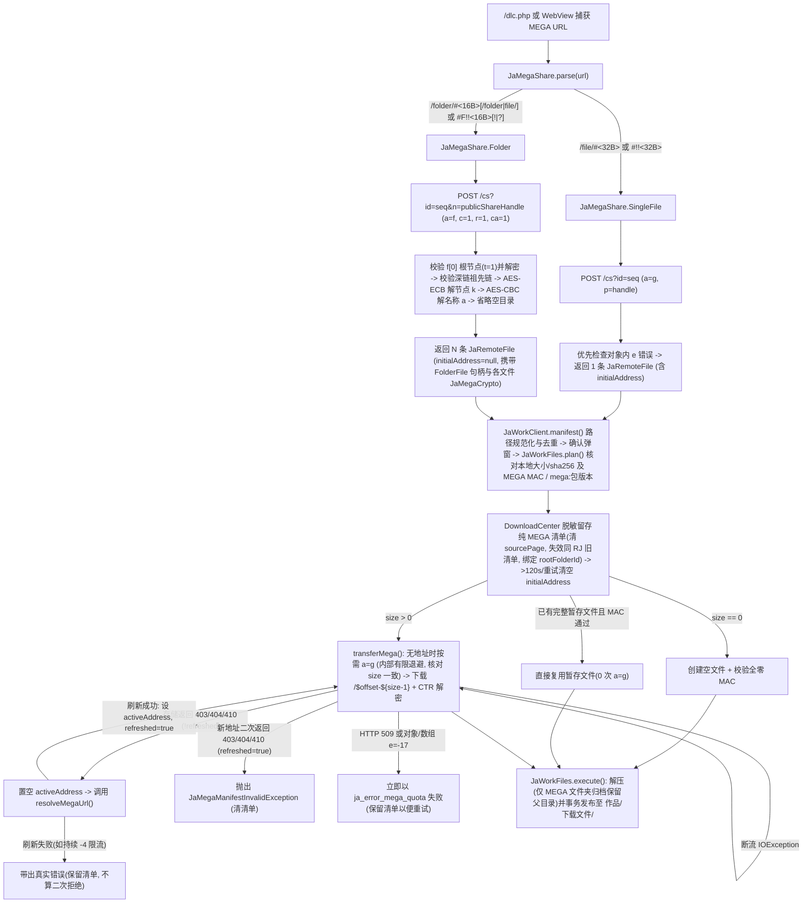

# Android 端 JA 来源 MEGA 多文件（文件夹）下载实施计划

## 1. 目标说明

当前 Android 端 Japanese ASMR（JA）整作下载仅实现了 MEGA **公开单文件分享**协议（`mega.nz/file/...` 与 `#!...!...`）。当作品在 MEGA 网盘中以文件夹形式存放多个文件（例如 `RJ01068450`）时，链接为 `mega.nz/folder/...` 或 `#F!...!...`，会被 [JaMega.kt](../../app/src/main/java/com/nanahoshi/audioplayer/japaneseasmr/JaMega.kt#L50-L52) 直接拒绝并提示「暂不支持 MEGA 文件夹链接」。

本计划在**不引入 MEGA C++ SDK / NDK 依赖、不变更数据库表结构、不持久化密钥或临时地址**的前提下，用纯 Kotlin 补全 MEGA 公开文件夹（多文件及嵌套子目录）的解析、按需取直链、断点续传解密、已发布文件远端版本核对、MEGA 文件夹嵌套压缩包目录保留、纯 MEGA 清单同进程防冲突保留以及配额/大小变化容错，使多文件 MEGA 作品无缝接入现有的 [JaWorkFiles.kt](../../app/src/main/java/com/nanahoshi/audioplayer/data/JaWorkFiles.kt) 与 [DownloadCenter.kt](../../app/src/main/java/com/nanahoshi/audioplayer/data/DownloadCenter.kt) 管线。

---

## 2. 需要确认的设计决策

> [!IMPORTANT]
> **1. 剥离共享根名称、限定作用域的嵌套压缩包父路径保留与空子目录策略**
> - **根剥离与深链路径**：普通文件夹链接剥离共享根自身名称；子目录深链仅剥离所选子目录自身名称；单文件深链直接使用文件名。以上规则符合现有的 `(RJ 号, 相对路径)` 文件身份并保留内部层级。
> - **嵌套压缩包发布路径（仅限 MEGA 文件夹来源归档）**：解包条目保留压缩包所在父目录前缀（如 MEGA 文件夹中的 `特典/音声.zip` 解包后发布为 `特典/01.wav`，避免丢失 `特典/` 或与根目录同名文件冲突；根目录压缩包父路径为空，行为不变）。**该父路径规则仅适用于本次 MEGA 文件夹来源的归档**，其他来源（Buzzheavier、单文件 MEGA 等）维持现有扁平发布语义，避免命中旧包复用或在新路径重复发布、影响按 `(rj, relativePath)` 关联的曲目与字幕。
> - **空子目录策略**：MEGA 文件夹树仅输出文件节点（`t == 0`），**省略空子目录**；压缩包内部携带的空目录仍沿用 [JaWorkFiles.kt](../../app/src/main/java/com/nanahoshi/audioplayer/data/JaWorkFiles.kt#L309-L324) 现有保留逻辑。

> [!IMPORTANT]
> **2. 按需取直链、版本核对与替换语义分离、清单保留防旧覆盖与刷新预算**
> - **已发布文件的远端版本校验与替换语义分离（不改表结构、不污染 `sha256`）**：
>   - 抽出内容比对谓词 `sameContent(row, file)`（不限制 `row.packageKey == null`）：核对 `row.size == file.size`、`file.sha256 == null || row.sha256 == file.sha256`，且若 `file.transfer is JaFileTransfer.Mega`，额外调用 `file.transfer.crypto.verify(File(localPath))` 对本地明文字节重算 MEGA CBC-MAC；`JaDownloadEntryEntity.sha256` 严格保留文件内容的 SHA-256。
>   - **普通文件直接复用（`plan()`）**：`row.packageKey == null && intact(row) && sameContent(row, direct)`，避免把旧归档成员直接当作普通文件，同时防止同大小换内容被误复用。
>   - **普通文件改选入口替换判断（`check()` 的 `needsReplace` 与 `execute()` 的 `differentEntry && !jaReplace` 跳过分支）**：`previous?.localPath != null && intact(previous) && !sameContent(previous, direct)`，保留「磁盘损坏的旧文件（`!intact`）或来自旧归档但字节完全一致的文件（`packageKey != null && sameContent`）不误判为需要询问覆盖的有效冲突副本」的语义。
>   - **归档 MEGA 文件组（ZIP / RAR 及分卷）**：在 `JaDownloadPackageEntity.revision`（及关联 `JaDownloadEntryEntity.packageRevision`）记录 `"mega:" + jaHash(members.joinToString("/") { crypto.checksum })`，`JaDownloadPackageEntity.sha256` 保持 `null`；`plan()` 与 `check()` 要求 `row.revision == group.megaRevision`、`row.publishedAt != null` 且成员全部 `intact` 才复用（无 `"mega:"` 前缀的历史包记录视为未核对版本，不静默复用）。
>   - **核对能力标记同步**：普通 MEGA 文件与归档 MEGA 组均视为具备远端版本核对能力，同步更新 `check.lengthOnly` 与 `force` 判定。
> - **纯 MEGA 清单的同进程保留、防旧覆盖、重读回填与退敏收口**：
>   - **同一任务续用与防旧覆盖**：内存清单仅允许**同一任务**续用用户本次确认过的清单；只要同作品（`rj`）有更新清单被接受或生效——包括新任务入队（`enqueueJaWork`）、重试传入新清单（`retry(id, manifest, verification)`）、重启后重读取得新清单（`downloadJaWork`）、以及任一任务发布完成（`DONE`）——立即清理该 `rj` 下所有其他旧任务的内存清单，防止旧失败任务重试时用旧清单覆盖新任务已发布的版本。
>   - **仅限纯 MEGA 清单**：在 [DownloadCenter.kt](../../app/src/main/java/com/nanahoshi/audioplayer/data/DownloadCenter.kt) 中，对 `files.isNotEmpty() && files.all { it.transfer is JaFileTransfer.Mega }` 的清单启用同进程保留（不套用 120 秒 TTL），覆盖排队超过 2 分钟才启动、同进程内断流/限流/配额/中止后手动重试；**进程重启后首次成功重读 `/dlc.php` 获得的纯 MEGA 清单同样立即回填内存**，确保紧接着的同进程手动重试不必再重读入口。Buzzheavier 及混合清单保持原有 120 秒 TTL 不变。
>   - **脱敏收口与清理边界**：纯 MEGA 清单存入/留存内存时立即置 `sourcePage = null`、`verifiedBuzzPages = emptyMap()`（避免长期留存含完整分享链接或 `/dlc.php` HTML 的页面对象）；超过 120 秒启动、重试前回填或重试时均清空各条目的 `initialAddress`。在任务完成（`DONE`）、删除失败任务（`deleteFailed`）、作品或篇目从库中移除（监听文件夹移除事件一并清理已失败任务的清单，并在读取缓存时核对 `rootFolderId`）、应用进程重启，或发生「分享失效 / 远端文件大小变化 / 入口变化 / 刷新后新地址仍被拒绝」时立即回收清单。
> - **单文件直链刷新预算与真实错误保留**：
>   - 刷新预算按**单个文件的一次 `download()` 执行**计算，最多刷新 **1 次** `a: "g"`；文件夹文件首次按需调用 `a: "g"` 不消耗刷新预算。
>   - 一次取链或刷新在 `resolveMegaUrl()` 内部完成有限次退避重试（仅限 `-3`/`-4`/`-18`/瞬时 `IOException`），若仍失败则直接带出原错误（如 `ja_error_mega_busy`、`ja_error_mega_quota` 或网络 `IOException`），**不落回外层循环用旧地址再访存储，也不抛清单失效异常**。
>   - 仅当存储节点返回 `403 / 404 / 410` 时先置空 `activeAddress`：若 `!refreshed`，调用 `resolveMegaUrl()`；**只有在成功拿到新地址后才赋值 `activeAddress` 并置 `refreshed = true`**；若刷新本身失败则直接带出真实错误并保留纯 MEGA 清单；后续断流重试沿用已获取/已刷新的 `activeAddress`；只有**成功拿到的新地址**再次被存储以 `403 / 404 / 410` 拒绝时，才抛出 `JaMegaManifestInvalidException` 触发清单失效。

> [!NOTE]
> **3. 协议范围、安全边界与配额失败退路**
> - **协议与安全边界**：仅支持 MEGA 公开匿名分享（单文件与文件夹），不引入 MEGA 账号登录；沿用归档限制（`.7z` / `.001` 分卷与加密压缩包仍拒绝并提示）；保留 HTTPS、443 端口、`.mega.co.nz` / `.mega.nz` 主机及无 URL 凭证校验。`JaFileTransfer.Mega`、`JaMegaShare.SingleFile`、`JaMegaShare.Folder` 与 `FileDetails` 均不使用默认暴露完整 URL 或密钥的 `data class`（或显式覆写 `toString()` 屏蔽地址与密钥），纯 MEGA 缓存清单同时剥离 `sourcePage`，所有密钥、Cookie 与临时下载地址仅驻内存，不落库、不进日志或任务摘要。
> - **对象内 `"e"` 错误优先检查**：解析 `a: "f"` / `a: "g"` 响应对象时，先检查对象内 `"e"` 错误字段（如 `[{"e": -17}]`、`[{"s":..., "e": -17}]`），与裸整数 `-17`、单元素数组 `[-17]` 及存储端 HTTP `509` 统一归类为 `ja_error_mega_quota`。
> - **配额失败退路落地**：入队前准备阶段失败继续使用 [LibraryViewModel.kt](../../app/src/main/java/com/nanahoshi/audioplayer/ui/library/LibraryViewModel.kt#L777-L785) 现有弹窗的「改用播放器音轨下载」按钮；后台下载阶段失败不额外改造下载页交互，而是在 `ja_error_mega_quota` 错误文案中明确指引用户「`MEGA 下载流量已达上限，请稍后重试，或回到作品页改用播放器音轨下载`」。

---

## 3. 整体数据流



---

## 4. 变更方案

### 组件一：MEGA 协议与加解密

#### [MODIFY] [JaMega.kt](../../app/src/main/java/com/nanahoshi/audioplayer/japaneseasmr/JaMega.kt)

1. **拆分节点来源、分享目标与异常层次**（普通类或覆写 `toString()` 隐藏密钥字节与临时 URL）：
   ```kotlin
   internal sealed interface JaMegaFileSource {
       data class PublicFile(val handle: String) : JaMegaFileSource
       data class FolderFile(val folderHandle: String, val nodeHandle: String) : JaMegaFileSource
   }

   internal class JaMegaFatalException(
       userText: TextRef,
       persistedError: String? = null,
   ) : JaWorkException(userText, persistedError)

   internal class JaMegaManifestInvalidException(
       userText: TextRef,
       persistedError: String? = null,
   ) : JaWorkException(userText, persistedError)

   internal class JaMegaTransientException(
       userText: TextRef,
       persistedError: String? = null,
   ) : JaWorkException(userText, persistedError)

   internal sealed class JaMegaShare {
       class SingleFile(val handle: String, val crypto: JaMegaCrypto) : JaMegaShare()
       class Folder(
           val handle: String, // publicShareHandle，用于 URL 与 ?n=
           private val folderKey: ByteArray,
           val focusHandle: String? = null,
           val focusKind: FocusKind? = null,
       ) : JaMegaShare() {
           enum class FocusKind { FOLDER, FILE }
           override fun toString(): String = "JaMegaShare.Folder(handle=$handle, focusHandle=$focusHandle, focusKind=$focusKind)"
       }
   }
   ```
   `FileDetails` 亦覆写 `toString()` 屏蔽 `address` 完整链接。

2. **精确解析单文件、文件夹与旧式 `?` / `!` 深链（`JaMegaShare.parse(url)`）**：
   - 单文件：`/file/<8-char>#<43..44-char>`、`/#!<8-char>!<43..44-char>`，解码后严格校验 **32 字节**；
   - 新式文件夹：
     - `/folder/<8-char>#<22..24-char>`（整文件夹）
     - `/folder/<8-char>#<22..24-char>/folder/<8-char>`（`FocusKind.FOLDER`）
     - `/folder/<8-char>#<22..24-char>/file/<8-char>`（`FocusKind.FILE`）
   - 旧式文件夹（均在 `url.fragment` 内）：
     - `#F!<8-char>!<22..24-char>`（整文件夹）
     - `#F!<8-char>!<22..24-char>!<8-char>` → **严格作为 `FocusKind.FOLDER`**
     - `#F!<8-char>!<22..24-char>?<8-char>` → **严格作为 `FocusKind.FILE`**
   - 文件夹密钥解码后严格校验为 **16 字节**；移除原有的 `ja_error_mega_folder` 拦截分支。

3. **统一 MEGA API 请求构造与错误码解析**：
   - `folderListRequest(apiBase, seq)`：`POST https://g.api.mega.co.nz/cs?id=<seq>&n=<publicShareHandle>`，请求体 `[{"a":"f","c":1,"r":1,"ca":1}]`；
   - `downloadUrlRequest(apiBase, seq, source)`：
     - `PublicFile(h)` → `POST .../cs?id=<seq>` + `[{"a":"g","p":"<h>","g":1,"ssl":2}]`；
     - `FolderFile(fh, nh)` → `POST .../cs?id=<seq>&n=<fh>` + `[{"a":"g","n":"<nh>","g":1,"ssl":2}]`；
   - **错误码优先与全覆盖**：对 API 响应：
     - 若为裸整数（如 `-9`、`-17`）或单元素整数数组（如 `[-17]`），按错误码映射；
     - 若为单元素 `JsonObject`（如 `[{"e": -17}]` 或包含其他字段的对象），**先读取 `obj["e"]`**，若为负整数则按同套错误码映射后再校验 `"g"` / `"f"`；
     - 错误码映射：
       - `-3`、`-4`、`-18` → `JaMegaTransientException(TextRef.Res(R.string.ja_error_mega_busy))`
       - `-17` → `JaMegaFatalException(TextRef.Res(R.string.ja_error_mega_quota))`
       - `-9`、`-11`、`-16` 及其他负码或非法 JSON → `JaMegaFatalException(TextRef.Res(R.string.ja_error_mega_share_expired))`
   - `resolveDownloadUrl(json, expectedSize)`：校验 `"g"` 为 HTTPS 443 且主机以 `.mega.co.nz` / `.mega.nz` 结尾且无用户名/密码；若响应包含 `"s"` 且与 `expectedSize` 不一致，抛出 `JaMegaManifestInvalidException(TextRef.Res(R.string.ja_error_mega_size_changed))`。

4. **公开文件夹树解密、`f[0]` 根节点识别与三种空/错状态区分（`Folder.resolveTree(json)`）**：
   - 解析 `[{"f": [...]}]`，从 `f` 数组中先检验 **`f.firstOrNull()`**：
     - 必须存在且为目录节点（`t == 1`），记录其句柄为 **`rootHandle`**（不假设 `rootHandle == publicShareHandle`）；
     - 解析节点密钥 `k`（按 `/` 拆分 `<owner>:<base64>` 候选，优先匹配 `owner == rootHandle` 或 `owner == publicShareHandle`，其余作为后备）：用 16 字节 `folderKey` 做 `AES/ECB/NoPadding` 解得 16 字节目录密钥，并用 `AES/CBC/NoPadding`（全零 IV）解密其属性 `"a"`，校验明文以 `MEGA{` 开头且 `"n"` 非空。若 `f[0]` 缺失、非目录或解密失败，立即抛出 `JaMegaFatalException(TextRef.Res(R.string.ja_error_mega_share_expired))`。
   - 先建立全部原始节点的 `rawNodes[h]` 映射，再解密目录节点（`t == 1` 且解密出 16 字节密钥与有效目录名）到 `decryptedDirs`：
     - **作用域判定**：`traversalRoot = if (focusHandle != null) focusHandle else rootHandle`；
     - 若 `focusHandle != null`：在 `rawNodes` 中定位 `target`，验证：
       - 若 `focusKind == FOLDER` 则 `target.t == 1`，若 `focusKind == FILE` 则 `target.t == 0`；
       - 从 `target.p`（若 `target.h != rootHandle`）沿原始节点表回溯至 `rootHandle`（用 `visited` 防环），且路径上所有祖先（以及当 `target.t == 1` 时 `target` 自身）必须在 `decryptedDirs` 中；
       - 不满足以上任一条件则抛出 `JaMegaFatalException(TextRef.Res(R.string.ja_error_mega_share_expired))`；
       - 若为单文件深链（`target.t == 0`）：直接校验该文件自身密钥/属性（32 字节、`s >= 0L`、名称不含 `/` 与 `\`）输出单条记录或计 `skipped = 1`。
     - 对所有文件节点（`t == 0`）：
       - 先按 `rawNodes` 沿 `p` 向上（带 `visited` 防环）判断该文件是否落在 `traversalRoot` 子树下（若未抵达 `traversalRoot`，说明属于作用域外或成环孤儿，直接忽略不计入 `skipped`）；
       - 若确实属于 `traversalRoot` 子树，再校验从 `node.p` 到 `traversalRoot` 之间的每个中间目录都存在于 `decryptedDirs` 且名称不含 `/` 与 `\`，且该文件自身（`s >= 0L`、32 字节密钥、`MEGA{` 属性、文件名不含 `/` 与 `\`）解密成功：成功则剥离 `traversalRoot` 及其以上各层名称生成 `relativePath`；**中间目录无法解密、中间祖先非目录、路径含非法分隔符或文件自身损坏，均计入 `skipped`**。
     - 对有效结果按 `jaWorkPathKey(relativePath)` 与 `nodeHandle` 稳定排序；
     - **三种结果状态区分**：
       - 作用域内没有任何文件节点（`files.isEmpty() && skipped == 0`）→ 抛出 `JaMegaFatalException(TextRef.Res(R.string.ja_error_mega_empty_folder))`；
       - 作用域内有文件但全部因中间目录无法解密、路径非法或损坏被跳过（`files.isEmpty() && skipped > 0`）→ 返回空列表与 `skipped`，交由 `JaWorkClient.manifest()` 统一抛出 `ja_error_download_unavailable`，不误报空文件夹或密钥失效。

5. **0 字节文件兼容**：
   - 单文件与文件夹文件的大小校验均改为 `size >= 0L`；`JaMegaCrypto.verify()` 对 0 字节文件天然计算全零 MAC 与 `expectedMac` 比对。

---

### 组件二：整作客户端（清单展开、字节上限、单文件刷新预算与真实错误保留）

#### [MODIFY] [JaWorkClient.kt](../../app/src/main/java/com/nanahoshi/audioplayer/japaneseasmr/JaWorkClient.kt)

1. **调整 `JaFileTransfer.Mega`**：
   ```kotlin
   class Mega(
       val source: JaMegaFileSource,
       val crypto: JaMegaCrypto,
       val initialAddress: HttpUrl? = null,
   ) : JaFileTransfer {
       fun withoutInitialAddress(): Mega = if (initialAddress == null) this else Mega(source, crypto, null)
       override fun equals(other: Any?): Boolean =
           other is Mega && source == other.source && crypto.checksum == other.crypto.checksum && initialAddress == other.initialAddress
       override fun hashCode(): Int = Objects.hash(source, crypto.checksum, initialAddress)
       override fun toString(): String = "Mega(source=$source, checksum=${crypto.checksum}, hasInitial=${initialAddress != null})"
   }
   ```
   新增 `private val megaSeq = AtomicLong(1)` 生成每次 `/cs` 请求序号 `id`。

2. **扩展 `manifest()` 与按字节数限制的 JSON 读取**：
   - 新增常量 `private const val MAX_MEGA_FOLDER_JSON = 8L * 1024 * 1024`（8 MiB）；
   - 读取 MEGA API 响应体使用 `val bytes = response.peekBody(MAX_MEGA_FOLDER_JSON + 1).bytes(); if (bytes.size > MAX_MEGA_FOLDER_JSON) unavailable(); val body = bytes.toString(Charsets.UTF_8)`，**严格按 UTF-8 字节数**判定 8 MiB 上限；
   - `mega(url)` 改为返回 `JaMegaResolved(val files: List<JaRemoteFile>, val skipped: Int)`：
     - `SingleFile`：发 `a: "g"`（内部有限次退避重试 `-3`/`-4`/`-18`/瞬时 `IOException`），返回单条 `JaRemoteFile`（含 `initialAddress`）；
     - `Folder`：发 `a: "f"`（内部有限次退避重试，**0 次 `a: "g"`**），返回全部文件（`initialAddress = null`）与 `skipped`；
   - `manifest()` 循环中逐条处理 `resolved.files`，保留原有的 `normalizeJaWorkPath`、重名与目录覆盖校验，合并 `resolved.skipped`。

3. **改造 `transferMega()` 与 `download()`（单文件刷新预算 + 刷新失败保留真实错误）**：
   - 若 `size == 0L`：创建或截断 `out` 为 0 字节，不向存储节点发 `0--1` 请求，交由 `verify()` 完成 MAC 校验；
   - 若 `size > 0L`：在单文件一次 `download()` 执行内维护 `activeAddress: HttpUrl? = transfer.initialAddress` 与 `refreshed: Boolean = false`：
     - 新增内部辅助 `resolveMegaUrlWithRetry(source, expectedSize)`：内部对 `JaMegaTransientException` / 瞬时 `IOException` 做有限次退避重试（最多 2 次，遵循协程取消）；仍失败时直接抛出原错误（如 `ja_error_mega_busy`、`ja_error_mega_quota` 或 `IOException`）；
     - 进入单轮存储传输前，若 `activeAddress == null` 则先调用 `resolveMegaUrlWithRetry` 填充 `activeAddress`（首次取链不改 `refreshed`）；
     - 向 `$activeAddress/$offset-${size - 1}` 发请求；若存储节点响应 `403` / `404` / `410`：
       - 首先置 `activeAddress = null`（防止后续外层 `IOException` RETRY 误用已失效的旧地址）；
       - 若 `refreshed == true`（代表**已经成功刷新过一次的新地址**再次被存储拒绝）：抛出 `JaMegaManifestInvalidException(TextRef.Res(R.string.ja_error_download_address_expired))` 直接失败；
       - 若 `!refreshed`：调用 `resolveMegaUrlWithRetry(transfer.source, size)`；**仅当成功返回新地址后**才赋值 `activeAddress = fresh` 并置 `refreshed = true`，然后立即执行本次文件请求；**若刷新请求本身失败（例如持续 `-4` 限流），直接抛出刷新接口的真实错误（如 `ja_error_mega_busy`），不置 `refreshed = true`，不走 `JaMegaManifestInvalidException`**；
     - 若存储传输流中途抛出 `IOException`：由外层 `download()` 最多 3 轮重试继续执行，`activeAddress`（若已有新地址）与 `refreshed` 保持不变，从当前已写入偏移续传，**不重复请求 `a: "g"`，也不再重置刷新预算**。
   - **错误处理与重试边界**：
     - `checkMegaResponse()`：HTTP `509` 抛出 `JaMegaFatalException(TextRef.Res(R.string.ja_error_mega_quota))`；HTTP `429` / `503` 抛出 `JaMegaTransientException(TextRef.Res(R.string.ja_error_mega_busy))`；`401` 或 Challenge 抛出 `JaMegaFatalException(TextRef.Res(R.string.ja_error_mega_use_browser))`；存储端 `403 / 404 / 410` 交由上述刷新状态机处理；
     - `download()` 中遇到 `JaMegaFatalException`、`JaMegaManifestInvalidException` 或从刷新状态机直接带出的 `JaMegaTransientException`（代表刷新内部已耗尽重试）立即抛出结束；仅针对直连存储传输期间的短暂 `IOException` 与 `JaMegaTransientException`（如存储 `429`/`503`）执行外层重试并在重试前短退避。

4. **修复 `jaDownloadLinks()` 中 `meta refresh` 大小写及含分号 URL 截断问题**：
   - 将 [JaWorkClient.kt 第 182 行](../../app/src/main/java/com/nanahoshi/audioplayer/japaneseasmr/JaWorkClient.kt#L182) 提取逻辑替换为：
     `Regex("(?i)(?:^|[;,\\s])url\\s*=\\s*(.+)$").find(it.attr("content"))?.groupValues?.get(1)?.trim()?.trim('"', '\'')`，大小写不敏感且保留包含 `;` 的完整目标地址。

---

### 组件三：下游适配（发布版本核对、限定嵌套归档路径、防冲突清单保留）

#### [MODIFY] [JaWorkFiles.kt](../../app/src/main/java/com/nanahoshi/audioplayer/data/JaWorkFiles.kt)

1. **限定嵌套压缩包保留父目录路径（仅 MEGA 文件夹归档）**：
   - 在 `Group` 增加 `val preserveArchiveParent: Boolean`，仅当 `packageKey != null && files.all { (it.transfer as? JaFileTransfer.Mega)?.source is JaMegaFileSource.FolderFile }` 时为 `true`；
   - 计算 `val archiveParent = if (group.preserveArchiveParent) group.path.substringBeforeLast('/', "") else ""`；
   - 解压循环读取临时解压目录磁盘文件**仍使用未加前缀的 `File(unpacked, file.relativePath)`**，而传入 `accept()` 的目标相对路径拼接为 `if (archiveParent.isEmpty()) file.relativePath else "$archiveParent/${file.relativePath}"`；
   - 解压出来的空目录（`extraction.entries.filter { it.isDirectory }`）在 `archiveParent.isNotEmpty()` 时同样加上 `"$archiveParent/"` 前缀，并登记 `archiveParent` 及其祖先目录。其他来源（Buzzheavier、单文件 MEGA 等）保持 `archiveParent = ""`，不改变原有扁平路径与旧包复用行为。

2. **分离「内容一致性」「普通文件复用」与「改选入口替换判断」语义（不变更 DB Schema）**：
   - 抽取辅助函数：
     ```kotlin
     private suspend fun sameContent(row: JaDownloadEntryEntity, file: JaRemoteFile): Boolean {
         val path = row.localPath ?: return false
         if (row.size != file.size) return false
         if (file.sha256 != null && row.sha256 != file.sha256) return false
         val mega = file.transfer as? JaFileTransfer.Mega ?: return true
         return mega.crypto.verify(File(path))
     }
     ```
   - 在 `Group` 中新增 `megaRevision: String?`（归档组且成员均为 `JaFileTransfer.Mega` 时为 `"mega:" + jaHash(files.joinToString("/") { (it.transfer as JaFileTransfer.Mega).crypto.checksum })`）与 `hasRemoteVersion: Boolean`（`hash != null || megaRevision != null || (packageKey == null && files.singleOrNull()?.transfer is JaFileTransfer.Mega)`）；
   - **`plan()`（复用判定）**：
     - 普通文件（`key == null`）：`row.packageKey == null && intact(row) && sameContent(row, group.files.single())`；
     - 归档组（`key != null`）：满足 `row.size == group.size && row.publishedAt != null`，且若 `group.megaRevision != null` 则 `row.revision == group.megaRevision`，否则 `group.hash == null || row.sha256 == group.hash`，并且该版本已发布条目全部 `intact(it)`。
   - **`check()`（`needsReplace` 与 `lengthOnly`）**：
     - `lengthOnly = plan.groups.any { !it.hasRemoteVersion }`；
     - `needsReplace`：普通文件组判定 `plan.old[jaWorkPathKey(group.path)]?.let { it.localPath != null && intact(it) && !sameContent(it, group.files.single()) } == true`；归档组判定 `plan.old.values.any { it.localPath != null }`（沿用既有语义，同时在 `group !in reused` 时触发）。
   - **`execute()`（`differentEntry && job.jaReplace != true` 跳过与发布版本号写入）**：
     - 普通文件跳过条件：`previous?.localPath != null && differentEntry && job.jaReplace != true && intact(previous) && !sameContent(previous, direct)`（磁盘已损坏旧文件或同字节旧归档文件不再被误跳或强迫询问覆盖）；
     - 包版本记录：`packageRevision = group.megaRevision ?: group.hash ?: jaHash(downloads.map { jaFileSha256(it) }.joinToString("/"))` 写入 `JaDownloadPackageEntity.revision`（`sha256` 仍保持 `group.hash`）。

#### [MODIFY] [DownloadCenter.kt](../../app/src/main/java/com/nanahoshi/audioplayer/data/DownloadCenter.kt)

1. **防旧任务覆盖、脱敏留存与作用域绑定的纯 MEGA 清单管理**：
   - 调整 `AvailableManifest`：
     ```kotlin
     private data class AvailableManifest(
         val manifest: JaWorkManifest,
         val rootFolderId: Long,
         val expires: Long,
         val pureMega: Boolean = manifest.files.isNotEmpty() && manifest.files.all { it.transfer is JaFileTransfer.Mega },
     )
     ```
     为 `JaWorkManifest` 增加脱敏辅助 `forRetention(keepInitialAddress: Boolean)`：当 `pureMega` 时**强制剥离 `sourcePage = null` 与 `verifiedBuzzPages = emptyMap()`**，并按需清空各 `JaFileTransfer.Mega` 的 `initialAddress`。
   - 抽取清单写入/失效辅助：
     - `rememberManifest(jobId: Long, rootFolderId: Long, rj: String, manifest: JaWorkManifest, keepInitialAddress: Boolean)`：若 `pureMega` 或在 120s 窗口内，清理同 `rj` 下所有 `jobId != existingJobId` 的旧清单后写入（`pureMega` 时剥离 `sourcePage`）；
     - `invalidateWorkManifests(rj: String, keepJobId: Long? = null)`：清理同一作品下旧任务的清单（在 `enqueueJaWork` 插入新任务、`retry` 传入新清单、`downloadJaWork` 重读新清单后、以及任务 `DONE` 时调用）；
     - `invalidateRootManifests(removedIds: Set<Long>)`：在 `DownloadCenter` 初始化阶段监听 `library.observeAllFolders()`，每当存在 `rootFolderId` 消失，立即移除 `jaWorkManifests` 中对应 `rootFolderId` 的全部条目（包含已 `FAILED` 的任务），以及清理对应的 `jaWaitingEntries` / `jaVerifications`（不引入 `LibraryRepository -> DownloadCenter` 的反向循环依赖）。
   - **读取、回填与清理时机（`downloadJaWork()` & `retry()`）**：
     - 读取 `jaWorkManifests[job.id]` 时，先核对 `cached.rootFolderId == job.workFolderId && cached.manifest.entry.post.postId == job.fileKey && cached.manifest.entry.post.rj == job.workKey`：
       - 若为 `pureMega`：若当前时间 `>= cached.expires`（排队超 2 分钟）或通过 `retry()` 重试，清空单文件 `initialAddress` 后继续执行（**不从 `jaWorkManifests` 中移除**）；
       - 若非 `pureMega`：沿用 120 秒 TTL，过期则移除；
     - 若未命中缓存而调用 `jaWorkClient.manifest(entry)` 成功且为 `pureMega`：立即调用 `rememberManifest(job.id, rootId, rj, fresh, keepInitialAddress = true)` 回填内存并使同 `rj` 旧任务清单失效（确保进程重启后首读成功，紧接着如中止/限流/断流失败时，手动重试无需重读 `/dlc.php`）；
     - `execute()` 正常完成后调用 `invalidateWorkManifests(rj)`；
     - 失败分支：仅当抛出 `JaMegaManifestInvalidException`、`ja_error_mega_share_expired` 或 `ja_error_entry_changed` 时立即移除 `jaWorkManifests.remove(job.id)`；若为 `JaMegaTransientException`、配额（`ja_error_mega_quota`）、普通网络 `IOException` 或用户点击 `cancel(id)` 中止，保留 `pureMega` 缓存并在下次取出前剥离 `initialAddress`；`deleteFailed(id)` 时移除 `jaWorkManifests.remove(id)`。

#### 无需改动项确认
- [JapaneseAsmrVerificationScreen.kt](../../app/src/main/java/com/nanahoshi/audioplayer/ui/asmr/JapaneseAsmrVerificationScreen.kt)：已按 `megaHosts` 完整保留含 `#fragment`（包括 `#F!...?...`、`#F!...!...`、`/folder/...#...`）的捕获与跳转，且 Cookie 提供器仅用于 `buzzheavier.com`，无需修改；
- `AppDatabase.kt`：数据库版本保持 **22**，复用 `JaDownloadEntryEntity` 与 `JaDownloadPackageEntity.revision`，无需新增列或编写迁移。

---

### 组件四：文案资源与文档同步

#### [MODIFY] [strings_japaneseasmr.xml](../../app/src/main/res/values/strings_japaneseasmr.xml)
- 移除不再使用的 `ja_error_mega_folder`；
- 新增：
  - `ja_error_mega_quota`：`MEGA 下载流量已达上限，请稍后重试，或回到作品页改用播放器音轨下载`
  - `ja_error_mega_busy`：`MEGA 服务繁忙或请求过于频繁，请稍后重试`
  - `ja_error_mega_empty_folder`：`这个 MEGA 文件夹里没有可下载的文件`
  - `ja_error_mega_size_changed`：`远端文件大小已变化，请重新读取下载清单后重试`

#### [MODIFY] [japaneseasmr-api.md](../japaneseasmr-api.md)
- 更新第 9 节 [第 308 行](../japaneseasmr-api.md#L308) 及整作下载说明：记录 MEGA 公开单文件与公开文件夹分享的协议实现（`a: "f"` 目录树及 `f[0]` 根节点识别、新旧 `?` / `!` 深链、剥离共享根、省略空子目录、仅 MEGA 文件夹归档保留父目录、按需取 `a: "g"`、单文件 1 次刷新预算及刷新失败保留原错误、普通文件 CBC-MAC 与归档 `mega:` 版本复用、纯 MEGA 清单同进程脱敏保留与防旧覆盖边界、对象内 `e` 错误与 509 配额限制），加密包和 7z 仍提示限制。

#### [MODIFY] [README.md](../../README.md)
- 更新 [第 299-301 行](../../README.md#L299-L301) 附近的 JA 整作下载说明：补充支持 MEGA 多文件文件夹（含子目录保留、文件夹内压缩包目录保留、省略空目录）、同进程中止/限流后重试不重复请求入口，以及遇流量上限时回到作品页改用播放器音轨下载的指引。

---

## 5. 验证计划

### 5.1 JVM 单元测试

#### [MODIFY] [JaWorkDownloadTest.kt](../../app/src/test/java/com/nanahoshi/audioplayer/japaneseasmr/JaWorkDownloadTest.kt)

使用纯 Kotlin 合成标准 AES-ECB / AES-CBC / AES-CTR / CBC-MAC 夹具（不访问网络、不依赖 Android `org.json`），且**显式使 `publicShareHandle != rootNodeHandle`**，覆盖：
1. **单文件回归**：保留并验证原有 `megaResumesByByteOffsetAndChecksIntegrity`（`mega.nz/file/...` 与 `#!...!...`）。
2. **公开文件夹全流程**（新式 `/folder/<pub>#<16B>` 与旧式 `#F!<pub>!<16B>`）：
   - 正确从 `f[0]` 识别 `rootHandle`（区别于 `publicShareHandle`），剥离共享根名称并重建嵌套子目录，省略空子目录；多组 `/` 分隔 `k` 匹配；
   - 断言 `manifest()` 仅发 1 次 `a: "f"`（`?n=<pub>`）且 **0 次** `a: "g"`；
   - 下载每个文件时按需发 `a: "g"`（`?n=<pub>` + `"n": "<nodeHandle>"`），支持断流续传并校验明文与 CBC-MAC；
   - 已完整暂存并通过 MAC 校验的文件再次调用 `download()` 直接复用且 0 次请求 `a: "g"`。
3. **深链格式与祖先安全校验**：
   - 新式 `/folder/<pub>#<k>/folder/<sub>`、`/folder/<pub>#<k>/file/<file>`；
   - 旧式 `#F!<pub>!<k>!<subFolder>`（仅允许目录节点）与 `#F!<pub>!<k>?<fileNode>`（仅允许文件节点）；
   - 拒绝类型不符（如 `!` 指向文件、`?` 指向目录）、目标不属于 `f[0]` 根、或祖先链含非目录/未解密节点。
4. **三种错误/空状态精确区分**：
   - 错误密钥或 `f[0]` 解密失败 → `ja_error_mega_share_expired`；
   - 目标根下无任何 `t == 0` 文件节点 → `ja_error_mega_empty_folder`；
   - **共享根下有文件，但中间目录无法解密**（以及路径非法或损坏导致 `files.isEmpty() && skipped > 0`）→ `manifest()` 报 `ja_error_download_unavailable`，不误报空文件夹或密钥失效。
5. **单文件直链刷新预算、真实错误保留与大小变化**：
   - 首次下载返回 `403` / `410` 时刷新 1 次 `a: "g"`，随后断流再重试时**沿用已刷新的地址**不再请求 `a: "g"`，并断言精确请求次数；
   - 刷新后的地址第二次返回 `403` / `410` 时立即失败，不发起第二次 `a: "g"` 刷新，断言 `a: "g"` 精确调用次数；
   - **旧地址被存储拒绝（`403` / `410`）→ 刷新接口 `a: "g"` 持续返回 `-4` 限流 → 不再用旧地址访问存储、不抛出 `JaMegaManifestInvalidException`、保留真实错误 `ja_error_mega_busy`**；
   - `a: "g"` 返回的 `"s"` 与清单 `file.size` 不符时立即抛出 `JaMegaManifestInvalidException` 中止本轮下载。
6. **对象内错误、字节上限与边界**：
   - 对象内 `[{"e": -17}]`、`[{"s": 10, "e": -17}]`、数组 `[-17]` 与存储 HTTP `509` 均立即抛出 `ja_error_mega_quota` 且不重试；`-3`/`-4`/`-18` 自动短退避重试；
   - `a: "f"` 响应超过 8 MiB（按 UTF-8 字节数含多字节字符校验）拒绝解析；
   - 文件夹内 0 字节文件生成空文件并通过全零 MAC 校验，不发 `0--1` 请求；父节点成环不死循环；
   - `meta[http-equiv=refresh]` 大写 `URL=` 且地址本身包含分号 `;` 时完整提取不截断；
   - 确认 `JaFileTransfer.Mega`、`JaMegaShare.Folder` 与 `FileDetails` 的 `toString()` 不包含完整 URL 或密钥。

执行命令：
```sh
cd Android
export GRADLE_USER_HOME="$HOME/.gradle"
./gradlew :app:compileDebugKotlin :app:testDebugUnitTest \
  --tests com.nanahoshi.audioplayer.japaneseasmr.JaWorkDownloadTest \
  --tests com.nanahoshi.audioplayer.japaneseasmr.JapaneseAsmrTest \
  --no-configuration-cache
```

### 5.2 模拟器仪器测试（`audiotest_api36`）

#### [MODIFY] [JaWorkFilesAndroidTest.kt](../../app/src/androidTest/java/com/nanahoshi/audioplayer/japaneseasmr/JaWorkFilesAndroidTest.kt)

新增端到端集成测试，覆盖：
1. **同路径同大小内容更新识别与版本一致零次取链**：普通 MEGA 文件保持相同文件名与字节大小但更换内容（以及归档 MEGA 保持相同大小但更换内容生成新 `mega:` packageRevision），验证 `check()` 识别出变更、`execute()` 重新下载并覆盖发布；版本一致再次 `check()` / `execute()` 时，**对所有实际无需传输入库或已存在的文件 0 次请求 `a: "g"` 与存储服务器**。
2. **改选入口、同大小内容不同、拒绝替换后保留旧文件**：
   - 验证普通 MEGA 文件改选入口且同大小但内容不同时，`check()` 报告 `needsReplace = true`，`jaReplace = false` 执行后保留原有本地文件且不覆盖内容；
   - 验证磁盘已损坏旧文件（`!intact`）或来自旧归档但字节完全一致的文件（`packageKey != null && sameContent`）不被误判为替换冲突。
3. **限定作用域的嵌套归档父路径发布**：
   - MEGA 文件夹内的 `特典/音声.zip` 与根目录同名 `01.wav` 同包发布时，解包内容正确发布到 `特典/01.wav` 且不与根目录 `01.wav` 冲突；
   - 对照验证非 MEGA 文件夹来源（如 Buzzheavier）子路径归档仍保持原有扁平发布语义不受影响。
4. **纯 MEGA 清单同进程生命周期与脱敏**：
   - 验证排队超过 120 秒启动、以及用户中止或配额/网络失败后同进程手动重试，**不重读 `/dlc.php`** 且仅针对实际需要传输的非空文件请求 `a: "g"`（0 字节与已复用文件不取链）；
   - 验证「旧地址被拒 → 刷新接口持续 `-4` 限流」后保留纯 MEGA 内存清单且错误显示限流（`ja_error_mega_busy`），再试可直接恢复；
   - 验证**进程重启后**（新构造的 `DownloadCenter` 实例）首次重读 `/dlc.php` 成功后回填内存清单，紧接着中止/失败再重试不再重读入口；
   - 验证**防旧任务覆盖**：同作品新任务入队/发布后旧失败任务的纯 MEGA 清单失效，不能再以旧清单覆盖新版；
   - 验证**移除作品清理**：从库中移除作品后，该作品已失败任务的内存清单同步失效且无法串用。

执行命令（headless 模拟器 `audiotest_api36`）：
```sh
cd Android
export GRADLE_USER_HOME="$HOME/.gradle"
./gradlew :app:connectedDebugAndroidTest --no-configuration-cache \
  -Pandroid.testInstrumentationRunnerArguments.class=com.nanahoshi.audioplayer.japaneseasmr.JaWorkFilesAndroidTest
```
（注：按项目规范，在模拟器或真机安装应用前须获得用户明确授权。）

### 5.3 真机手工验证（须获得用户明确安装授权后在 Realme RMX5010 上进行）

1. **MEGA 多文件作品整作下载（`RJ01068450`）**：
   - 验证 `/dlc.php` 解析后正确列出文件夹内文件数量与总大小，确认入队后正常下载、解密并发布至 `下载文件/` 及子目录，音频可离线播放，图片/文本可预览；
2. **自动断线续传验收**：
   - 下载大文件过程中切换网络造成断流，观察自动按字节偏移续传完成，分别记录是否重开篇目或重触发网页验证；
3. **中止后同进程手动重试验收**：
   - 下载过程中手动点「停止」中止，再在下载页点「重试」，观察是否直接恢复剩余文件，分别记录是否重开篇目或重触发网页验证（并与杀进程重启后预期重读入口的行为分开记录）；
4. **单文件 MEGA 与 Buzzheavier 回归**：
   - 回归验证一个单文件 MEGA 作品（如 `RJ202757`）和一个 Buzzheavier 作品，确认原有流程无回归。
